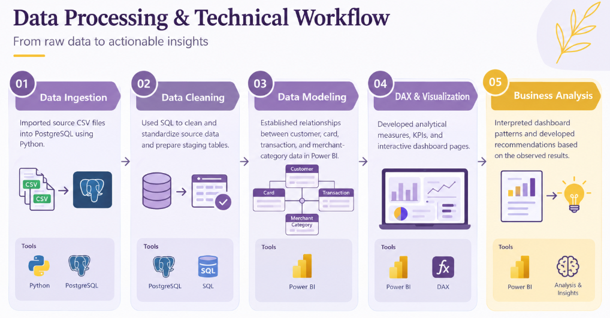
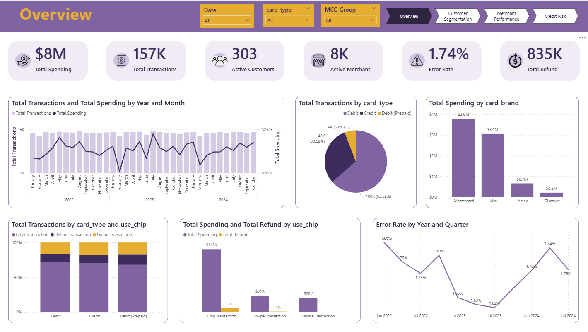
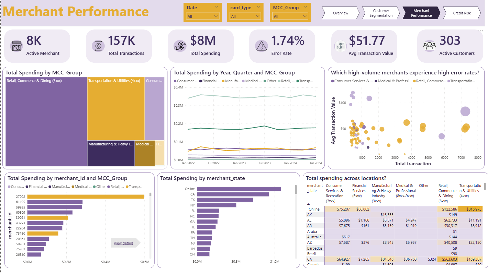

# Aurora Bank | Banking Analytics Dashboard

**Tools:** PostgreSQL · SQL · Python · Power Query · Power BI · DAX

## 1. Project Overview

Aurora Bank is an interactive banking analytics project designed to support data-driven decision-making across customer engagement, payment operations, and credit risk monitoring.

The dashboard integrates customer profiles, card information, transaction activity, and merchant categories to help management understand business performance, identify customer segments for further analysis, investigate payment issues, and monitor potential credit risk indicators.

## 2. Business Understanding — Design Thinking

### Phase 1 — Empathize | Stakeholder Analysis

**Primary Stakeholder: Head of Retail Banking**

| Key Question | Stakeholder Perspective |
|---|---|
| Who will view this dashboard? | The **Head of Retail Banking**, responsible for overseeing customer growth, card transaction performance, and retail credit portfolio quality. |
| What problem does this dashboard solve? | Provides a consolidated view of customer segments, transaction performance, and credit risk indicators to identify growth opportunities and areas requiring further investigation. |
| When and where will the dashboard be used? | During weekly performance reviews, monthly management meetings, and strategic planning sessions, primarily through Power BI on a work computer. |
| Why does this problem need to be solved? | To support sustainable business growth through improved customer engagement, payment performance monitoring, and early identification of potential credit risk concerns. |
| How does the stakeholder make decisions? | Uses a data-driven, exception-based approach to monitor KPIs, compare performance across segments, investigate anomalies, and prioritize actions based on business impact. |

### Phase 2 — Define | Problem Definition

**Core Problem**

Limited consolidated visibility into customer potential, payment performance, and credit risk indicators makes it difficult to identify opportunities and prioritize areas requiring further investigation.

**Problem Statement**

> How might we help the Head of Retail Banking identify customer growth opportunities, improve payment performance, and monitor credit risk indicators to support sustainable business growth?

## 3. Dataset Overview

The dataset contains four tables covering customer profiles, payment cards, transactions, and merchant categories.

| Table | Description |
|---|---|
| `users_data` | Customer demographics, income, debt, and credit scores |
| `cards_data` | Card information, card types, brands, and credit limits |
| `transactions_data` | Transaction amounts, payment methods, merchants, and errors |
| `mcc_codes` | Merchant category code descriptions |

### Data Limitation

The dataset does not include loan delinquency or default status. Therefore, the credit analysis focuses on **risk indicators rather than actual default probability or non-performing loan rates**.

Debt, income, credit score, and DTY Proxy patterns should be treated as signals for further investigation rather than definitive credit risk classifications.

## 4. Data Processing & Technical Workflow

## 5. Dashboard Structure & Business Insights

The dashboard consists of four pages, each designed to answer a specific business question.

| Dashboard Page | Business Question | Key KPIs |
|---|---|---|
| Overview | How is the bank performing overall? | Total Transactions, Total Spending, Active Customers, Active Merchants, Error Rate, Total Refunds |
| Customer Segmentation | Which customer segments contribute to spending, and where are the engagement opportunities? | Active Customers, Total Spending, Average Debt per Customer, Average DTY Proxy, Active Customer Rate, Median Yearly Income |
| Merchant Performance | Which merchant categories and locations account for the largest spending totals, and where should performance be investigated? | Active Merchants, Total Transactions, Total Spending, Error Rate, Average Transaction Value, Active Customers |
| Credit Risk | How is outstanding debt distributed across customer segments, and which groups warrant further review? | Total Debt, Average Debt per Customer, Average Credit Score, Average DTY Proxy, Low Credit Score Rate, Customers with Low Credit Score |

### 5.1 Overview — Banking Performance

**Key Findings**

- **Debit dominates transaction activity:** Debit accounts for approximately 63.62% of transactions, followed by Credit at 30.58% and Debit (Prepaid) at 5.80%.
- **Spending is concentrated across major card brands:** Mastercard contributes approximately $3.8M in spending, followed by Visa at $3.1M. Amex and Discover contribute considerably smaller totals.
- **The error rate fluctuates over time:** It decreases from approximately 1.86% in early 2022 to a low near 1.62% in 2023, before increasing again during 2024.
- **Chip transactions lead in total spending:** Chip transactions account for approximately $118K in spending, compared with $31K for Swipe and $26K for Online transactions.
- **Monthly activity is relatively stable:** Transaction counts remain around 4K–5K across much of the displayed period, while total spending fluctuates.

**Business Implications**

Debit, major card brands, and chip transactions are important contributors to payment activity. The changing error rate warrants further investigation by payment method, merchant, and time period.

High transaction volume or spending does not automatically imply higher profitability. Additional cost and revenue data would be needed to assess financial performance.

### 5.2 Customer Segmentation — Customer Behavior & Engagement

**Key Findings**

- **Customer activity requires further investigation:** The dashboard reports 303 active customers and an active customer rate of 15.15%. The definition and measurement period for active customers should be confirmed before evaluating this rate against a business target.
- **Spending is concentrated in lower-to-middle income groups:** The income-group chart shows higher total spending in several groups below approximately $50K in annual income.
- **Income alone does not explain spending behavior:** Most customers cluster at lower-to-middle income and spending levels, while some higher-income customers also exhibit high spending.
- **Average debt differs across age groups:** Young Adults (18–24) have the highest displayed average debt per customer at approximately $81K, followed by Adults (25–34) at $79K, Middle Aged (35–49) at $71K, and Seniors (50+) at $54K.
- **Debt exposure varies across income segments:** The age-and-income matrix highlights differences in outstanding debt across customer groups.

**Business Implications**

Customer segmentation should combine income with actual activity and spending behavior rather than relying on demographics alone.

The reported active customer rate suggests an opportunity to investigate inactive customers and potential reactivation strategies. Higher average debt among younger customers also warrants further analysis, but does not by itself establish that this group has higher credit risk.

### 5.3 Merchant Performance — Payment Activity & Merchant Concentration

**Key Findings**

- **Spending is concentrated in selected merchant categories:** Retail, Commerce & Dining and Transportation & Utilities are among the largest contributors to total spending.
- **Major category spending is relatively stable over time:** Several leading merchant categories maintain broadly consistent spending levels throughout the displayed 2022–2024 period.
- **A small number of merchants account for substantial spending:** Merchant ID `27092` has the highest displayed total spending among the listed merchants, at approximately $0.6M.
- **Online activity is a major spending category:** `_Online` leads the displayed merchant-state spending chart at approximately $1.1M, followed by CA and TX. Online activity should be analyzed separately from physical geographic locations.
- **Merchant performance requires more granular analysis:** The current scatter plot compares total transactions with average transaction value, but does not directly display error rates.

**Business Implications**

Major merchant categories and high-spending merchants are important groups to monitor because changes in their activity may materially affect overall payment volume.

To identify operational underperformance, the analysis should compare error rates and transaction volumes by merchant, payment channel, and merchant category.

High spending alone does not establish that a merchant is profitable or operationally problematic.

### 5.4 Credit Risk — Debt Exposure & Credit Score

**Key Findings**

- **Total outstanding debt is approximately $127M**, with an average credit score of approximately 710.
- **Good is the largest credit score band:** It contains 931 customers, followed by Very Good with 474, Fair with 348, Excellent with 166, and Poor with 81.
- **Debt distribution is right-skewed:** Most customers have comparatively lower debt, while a smaller number carry substantially larger balances.
- **Outstanding debt varies across income and credit score segments:** The income-by-credit-score matrix highlights several groups with notable debt exposure.
- **Some customers have substantial debt relative to their displayed income:** These cases may warrant further review, although income and debt alone cannot establish repayment capacity.
- **Credit score composition differs across DTY Proxy groups:** This pattern may be useful for further investigation, provided the definition and direction of the proxy are validated.

**Business Implications**

Debt exposure should be assessed alongside income, credit score, and repayment behavior where available.

Customers with high debt relative to income or lower credit scores may warrant additional review, but the current dataset cannot establish actual default probability because it lacks delinquency and default outcomes.

## 6. Cross-Dashboard Insights & Recommendations

| Key Insights | Recommendations |
|---|---|
| **Low customer activity:** The active customer rate is 15.15%, indicating potential opportunities to improve customer engagement. | Segment inactive customers by demographics and historical spending, then develop targeted reactivation campaigns. |
| **Fluctuating transaction error rate:** The error rate varies between approximately 1.62% and 1.86%, with no sustained downward trend. | Analyze error rates by payment method, merchant, and transaction period to identify and address the main contributors. |
| **Concentrated payment activity:** Spending is concentrated across major card brands, payment methods, and selected merchant categories. | Monitor high-volume channels and merchants, and evaluate their transaction success rates and processing costs. |
| **Uneven debt exposure:** Outstanding debt varies across income and credit score segments, with some customers carrying substantial debt relative to income. | Combine debt, income, and credit score indicators to identify segments for further review. Incorporate repayment history and delinquency data to strengthen risk assessment. |
